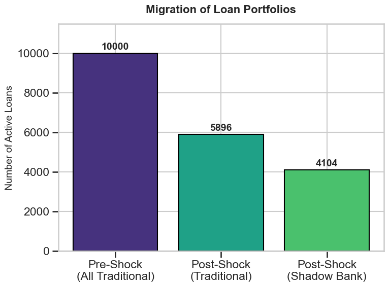
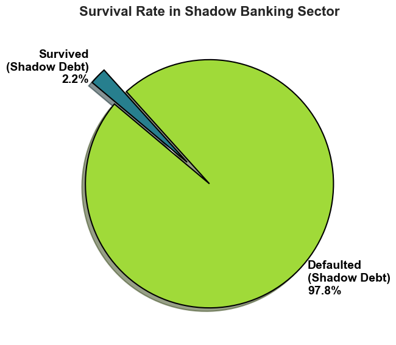
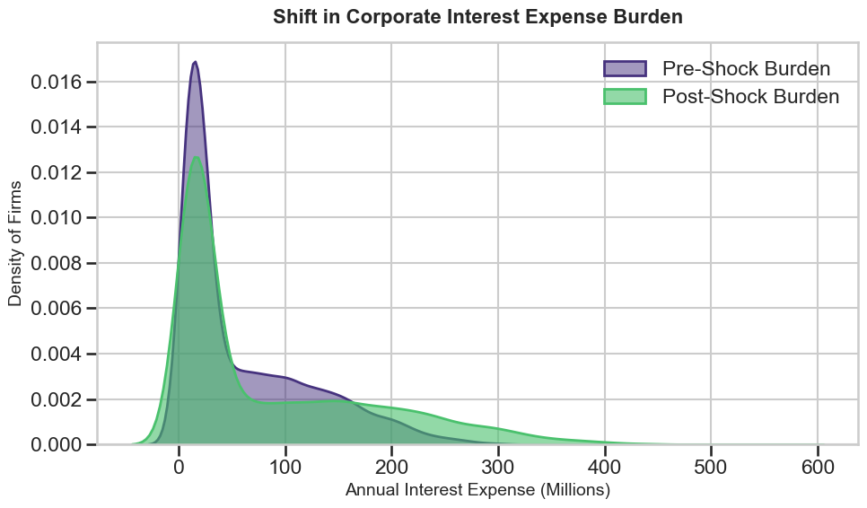
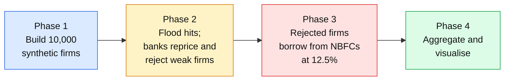

<div align="center">

<h1 align="center">Simulating Climate Risk Migration: The Shadow Banking Spillover Effect</h1>

<br/>

[](https://www.python.org/)
[](https://numpy.org/)
[](https://pandas.pydata.org/)
[](https://matplotlib.org/)
[](https://jupyter.org/)


**[The idea](#-the-idea)** ·
**[Results](#-results)** ·
**[How it works](#-how-it-works)** ·
**[The maths](#-the-maths-in-one-minute)** ·
**[Skills](#-skills-demonstrated)** ·
**[Run it](#-run-it-yourself)** ·
**[Limitations](#-honest-limitations)**

</div>

---

## 🌊 The idea

> **Climate Risk regulations in banking do not eliminate the overall macroecnomic systemic climate risk. The risk just migrates to somewhere else.**

Climate change is now a banking problem. Floods and storms damage businesses, and a damaged business may not repay its loan. Regulators around the world therefore push banks to measure climate risk carefully and to lend less to firms that have become too risky.

That sounds like exactly the right thing to do. This project asks a question that is easy to overlook:

> **When banks stop lending to climate-exposed firms, where do those firms go, and what happens to them there?**

My answer, tested with a computer simulation of 10,000 firms: they go to **shadow banks** (lightly regulated lenders called NBFCs) that charge much higher interest. Many of them then fail. The regulated banks look safer, but **the risk was moved, not removed.**

---

## 📌 At a glance

| | |
|---|---|
| **Project** | *Simulating Climate Risk Migration: The Shadow Banking Spillover Effect* |
| **Author** | Vaibhav Thakur, BS Economics, IISER Bhopal |
| **Type** | Two-part project: (1) a review of climate risk in banking, (2) an original simulation study |
| **Tools** | Python, NumPy, pandas, Matplotlib, seaborn, kernel density estimation, Jupyter |
| **Policy link** | Reserve Bank of India climate-risk framework, Basel Committee principles, NGFS and TCFD |
| **Read the full write-up** | [`Project_Report.pdf`](Project_Report.pdf) and [`Presentation.pdf`](Presentation.pdf) |
| **Run the code** | [`Simulation_Code.ipynb`](Simulation_Code.ipynb) (Code report: [`Simulation_Code_Report.pdf`](Simulation_Code_Report.pdf)) |

---

## 🔭 Results

- I simulated a synthetic economy of 10000 firms to test regulatory climate risk behavior.
- After a simulated severe flood shock, traditional banks aggressively de-risked. They hiked interest rates by 50 basis points for highly vulnerable firms and outright rejected 4104 firms whose Interest Coverage Ratios dropped below 1.5.
- While the traditional banking sector looked safer on paper, the macroeconomic risk did not disappear. It migrated.
- Unregulated Shadow Banks (NBFCs) stepped in to absorb all 4104 rejected firms, but charged an exorbitant 400 basis point risk premium.
- Because highly vulnerable firms were forced to take on extremely expensive shadow debt just to survive the shock, 4013 of them collapsed into default.
- Conclusion: Traditional bank climate stress tests are fundamentally flawed if they ignore shadow banking. Pushing climate risk out of regulated banks actually increases total systemic defaults.

### What the simulation found

| # | Finding | Evidence |
|:-:|---|---|
| **1** | **Credit migrates.** After a flood, 41% of firms lose their bank loan and move to shadow banks. | 5,896 stay with banks, 4,104 move to NBFCs |
| **2** | **The bank's book looks safer.** The firms that stay have stronger average coverage, so a stress test on banks alone would show *improvement*. | Higher average interest coverage among bank borrowers |
| **3** | **The migrated risk is fragile.** Almost every migrated firm fails under the higher shadow-bank interest rate. | 4,013 of 4,104 default (**97.8%**), only 91 survive |
| **4** | **The economy-wide cost of debt rises.** Total interest paid goes up and the tail of very heavy interest burdens gets thicker. | See the density plot below |

### The charts

<table>
<tr>
<td width="33%" align="center"><b>1. Credit moves from banks to shadow banks</b><br/></td>
<td width="33%" align="center"><b>2. Most migrated firms default</b><br/></td>
<td width="33%" align="center"><b>3. The interest burden gets heavier</b><br/></td>
</tr>
</table>

> **Why this matters for policy:** a climate stress test that only looks at regulated banks can report "risk reduced" when, for the economy as a whole, risk has simply moved somewhere nobody is watching.

---

## ⚙️ How it works

The simulation has **four phases**. Think of it as building a small artificial economy, hitting it with a flood, and watching what lenders and borrowers do.



| Phase | What happens | Key choices |
|---|---|---|
| **1. Synthetic economy** | Generate 10,000 firms, each with revenue, profit margin, debt and a flood-vulnerability score (1 to 100). | Revenue ~ Normal(500, 150²) clipped to [100, 2000]; margin ~ Uniform(10%, 30%); leverage drawn from a three-group mixture (50% / 25% / 25%) loosely calibrated to RBI data on corporate debt |
| **2. Flood and bank response** | A flood cuts every firm's earnings in proportion to its vulnerability. Banks raise the rate for the most exposed firms and **refuse to renew** any loan whose post-flood coverage falls below 1.5. | Revenue loss up to 35%; +50 bp for vulnerability above 50; approval cut-off at coverage 1.5 |
| **3. Shadow-bank spillover** | Every rejected firm is taken on by an NBFC, at a 400 bp premium. A firm **defaults** if its profit no longer covers its interest (coverage below 1.0). | NBFC rate 12.5% (versus 8.5% baseline) |
| **4. Visualisation** | Roll firm-level outcomes up to economy-wide totals and plot them. | Bar chart, pie chart, kernel density estimate (Gaussian kernel, Scott's bandwidth) |

**The one metric to know.** The *Interest Coverage Ratio* (ICR) asks: **how many times over can a firm's operating profit pay its interest bill?** An ICR of 3 means a comfortable cushion; an ICR below 1 means the firm cannot even pay its interest.

---

## 🧮 The maths in one minute

*For readers who like equations. Everyone else can skip to the next section.*

Each firm *i* has revenue $R_i$, EBITDA margin $m_i$, and debt $D_i = d_i R_i$ at rate $r$. Its **interest coverage** is

$$\mathrm{ICR}_i=\frac{\text{EBITDA}_i}{\text{Interest}_i}=\frac{m_i R_i}{r\,d_i R_i}=\frac{m_i}{r\,d_i}$$

Revenue cancels out, so coverage depends only on **margin and leverage**.

A flood with vulnerability score $V_i$ destroys a fraction $s_i = 0.35\,V_i/100$ of earnings, and the bank's new rate is $r_i$ (8.5%, or 9.0% if $V_i>50$). After the shock,

$$\mathrm{ICR}^{S}_i=\mathrm{ICR}_i\cdot\underbrace{\frac{(1-s_i)\,r}{r_i}}_{\varphi_i}$$

The bank renews only if $\mathrm{ICR}^{S}_i \ge 1.5$, which is the same as a **cut-off on the pre-flood ICR** that rises from about 1.5 for the safest firms to about 2.4 for the most exposed. A rejected firm then pays the NBFC rate $r_N = 12.5\%$:

$$\mathrm{ICR}^{F}_i=\mathrm{ICR}^{S}_i\cdot\frac{r_i}{r_N},\qquad \text{default if } \mathrm{ICR}^{F}_i<1$$

**Why 97.8% default.** The bank rejects firms whose coverage is below about 1.5 to 2.4. The NBFC rate then multiplies their interest bill by about 1.4 to 1.5 times, and a firm survives only if its coverage was already inside a very narrow window (about 2 to 7% of the cut-off). Almost nobody lands in that window.

<div align="center">

<br/><sub>Analytic view of the two thresholds against flood vulnerability, derived from the model's own rules.</sub>
</div>

---

## 💼 Skills demonstrated

| Area | What this project shows |
|---|---|
| **Quantitative modelling** | Designing a multi-stage agent-based model from scratch, deriving closed-form relations (coverage cancellation, approval cut-offs, survival window) and checking them against the simulation |
| **Statistics** | Probability distributions, mixture models, clipping and truncation effects, Monte Carlo sampling error, kernel density estimation (bandwidth selection) |
| **Python and data** | Vectorised NumPy and pandas on 10,000-row tables, reproducible seeded experiments, clean Matplotlib and seaborn charts |
| **Financial risk** | Credit risk concepts (interest coverage, default, risk-based pricing, credit rationing), physical versus transition climate risk, capital and regulatory context (CET1, RWA, Basel, NGFS, TCFD) |
| **Economics** | Spillovers, regulatory arbitrage, and why a micro-prudential fix can have a macro-level side effect |
| **Research practice** | Literature-grounded hypothesis, explicit assumptions, calibration to central-bank data, and an honest limitations section |
| **Communication** | A beginner-friendly review of climate risk in banking, a formal research write-up, and this README for non-specialists |

---

## 🗂️ Repository structure

```
Climate-Risk-Financial-Model/
├── README.md                    ← you are here
├── Vaibhav_Project_Report.pdf   ← full report (review + simulation + discussion)
├── Vaibhav_Code.ipynb           ← the simulation notebook (run this)
├── Vaibhav_Code.pdf             ← the executed notebook, readable without Python
└── assets/                      ← banner, animated diagrams and charts used in this README
```

### Where to start

| If you are… | Read this |
|---|---|
| **A recruiter or hiring manager** | The summary above, then the [Results](#-results) section (about 2 minutes) |
| **A research advisor or economist** | The report's Section 3, then the [limitations](#-honest-limitations) below |
| **A data or quant reader** | [`Vaibhav_Code.ipynb`](Vaibhav_Code.ipynb) and [The maths](#-the-maths-in-one-minute) |
| **New to climate finance** | Section 2 of the report, which explains climate risk in banking from the ground up |

---

## 🚀 Run it yourself

```bash
# 1. Clone
git clone https://github.com/<your-username>/Climate-Risk-Financial-Model.git
cd Climate-Risk-Financial-Model

# 2. Install the few libraries needed
pip install numpy pandas matplotlib seaborn scipy jupyter

# 3. Open the notebook and choose Kernel > Restart & Run All
jupyter notebook Vaibhav_Code.ipynb
```

The random seed is fixed at **101**, so you should get exactly the same 10,000 firms and the same numbers quoted above. Change the seed or any parameter (flood severity, the 1.5 cut-off, the 400 bp premium) to run your own experiment.

---

## ⚠️ Honest limitations

A simulation is only as good as its assumptions, so these are stated openly.

- **Synthetic, not real data.** The firms are drawn from distributions loosely calibrated to RBI statistics, and the project shows a *mechanism*, not a forecast for any specific bank.
- **Many rejected firms were already weak.** About 90% of the rejected firms were already below the 1.5 coverage line before the flood, so the flood mainly tips borderline firms over the edge.
- **The result depends on two parameters.** The 1.5 approval cut-off and the 400 bp NBFC premium drive the size of the 97.8% figure. The *direction* of the result is robust, but the exact percentage is not a universal number.
- **"Default" means interest-coverage distress.** It is not a model of legal bankruptcy, restructuring or fresh capital.
- **One run, no feedback.** Results come from a single seeded run, and banks and NBFCs do not react to each other's losses.
- **Independence assumed.** Flood vulnerability and leverage are drawn independently.

### Natural extensions

- Sensitivity analysis over the cut-off, the premium and the flood severity
- Many seeds, with confidence intervals around every headline number
- Correlating flood exposure with sector and leverage
- A feedback loop in which NBFC losses spill back to banks that fund them
- Calibration to firm-level data rather than aggregate debt shares

---

## 📚 References

- Das, A., Majilla, T., & Saurav, S. *Natural Disasters, Interest Rate Dynamics, and Economic Activities.* CAFRAL.
- Mathur, S., & Sarma, R. *Who Lends When It Floods? Banks vs Non-Banks.* CAFRAL.
- Reserve Bank of India (2023). Report, 28 December 2023; and Draft Framework on Climate Risk and Sustainable Finance.
- Basel Committee on Banking Supervision (2022). *Principles for the Effective Management and Supervision of Climate-Related Financial Risks.*
- Network for Greening the Financial System (2023). *NGFS Climate Scenarios.*
- Task Force on Climate-related Financial Disclosures (2017). *Final Report.*

The full bibliography is in the report.

---

<div align="center">

## 👋 About the author

**Vaibhav Thakur** · BS Economics, IISER Bhopal

Interested in climate finance, financial stability, quantitative modelling and empirical economics.

[](https://www.linkedin.com/in/YOUR-LINKEDIN)
[](mailto:YOUR-EMAIL)
[](https://github.com/YOUR-USERNAME)

<sub>If you found this interesting, a ⭐ on the repository is very welcome.</sub>

</div>
